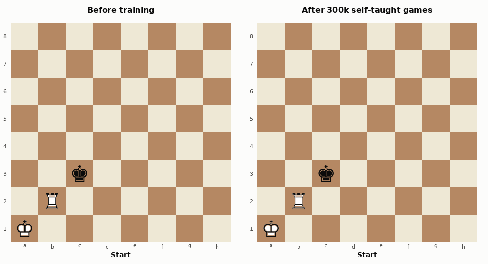
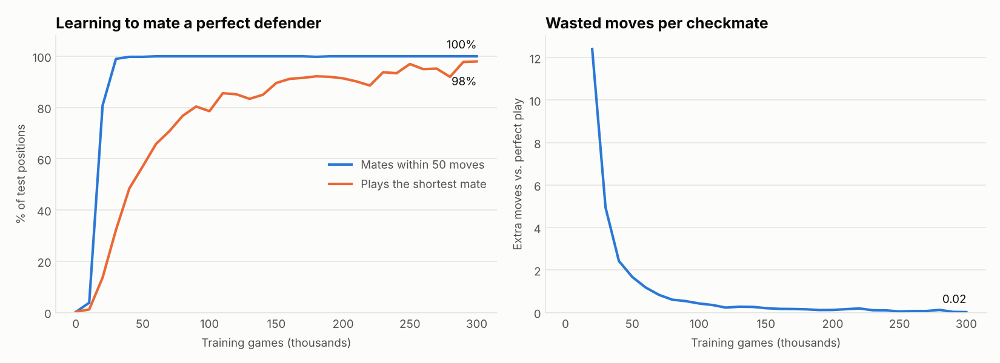
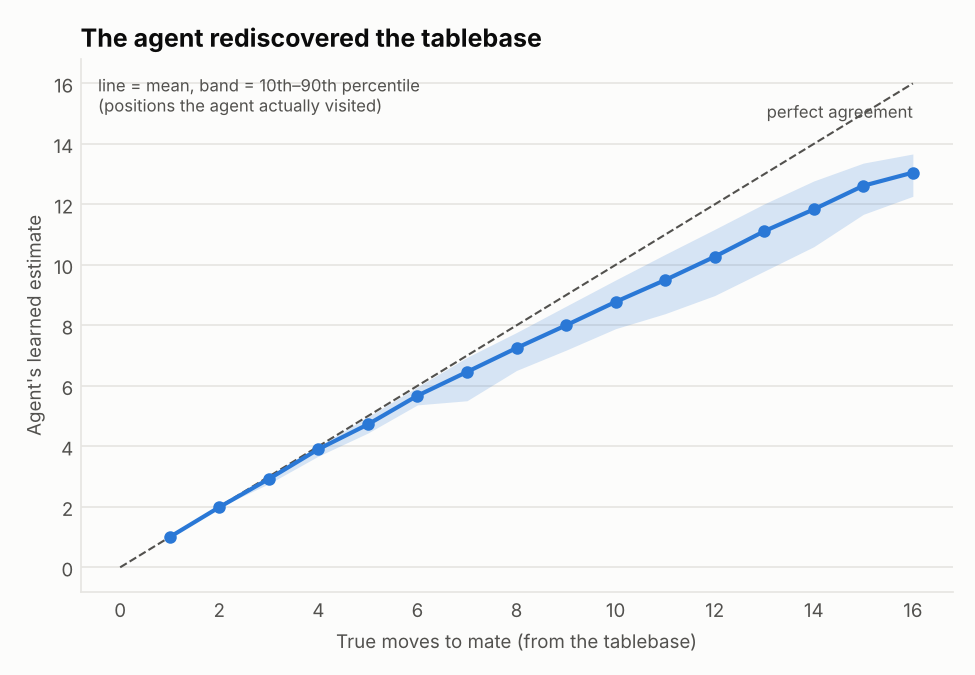

# Mate from Scratch ♖

**A reinforcement-learning agent that teaches itself to checkmate with King + Rook vs King, against an opponent that never makes a mistake. Trains in ~25 seconds on a laptop CPU. No neural nets, no chess engine, no datasets.**



*Left: the untrained agent wanders around and hangs its rook. Right: after 300k self-taught games, from one of the 121 hardest positions in the endgame, it delivers mate in exactly 16 moves, the provable minimum.*

---

## The idea

King + Rook vs King is the first endgame every chess player learns, and it is a surprisingly good RL problem:

- **It's always winnable**, but only if you know the technique. Random play almost never mates (0.1% of positions) and usually blunders the rook.
- **The reward is sparse.** You only find out you did something right at the very end, up to 16 moves later.
- **We can compute the perfect answer.** With retrograde analysis we solve every position exactly, so we can grade the agent against perfection rather than against another bot.

The agent is told only the legal moves. It knows nothing about "boxing in the king", "the opposition", or "driving to the edge". It has to rediscover all of that from wins and losses.

## How it works

The core is three small modules (plus plotting and scripts, ~750 lines in all):

**1. Rules (`krk/board.py`).** A tiny move generator for just three pieces, plus the 8 symmetries of the board (rotations and reflections). Mapping every position to its canonical form shrinks the state space ~8× to 28,056 positions.

**2. Perfect-play tablebase (`krk/tablebase.py`).** Retrograde analysis: start from every checkmate and work backwards, applying the minimax rule

```
mate-distance(white to move) = 1 + min over white moves of mate-distance(black to move)
mate-distance(black to move) = 1 + max over black moves of mate-distance(white to move)
```

Vectorised in NumPy, this solves the entire endgame in **under a second**. The tablebase does two jobs: it powers the **perfect defender** the agent trains against (always the reply that delays mate longest, and grabs the rook if it's ever left hanging), and it's the **answer key** for grading.

**3. The learner (`krk/agent.py`).** Tabular temporal-difference learning on *afterstates* (the position right after the agent moves). Each afterstate gets a value `V(b)` = "how many more moves until I mate from here". The agent always plays the move with the lowest `V`, then updates:

```
V(b) ← V(b) + α · (1 + V(b_next) − V(b))      # one more move, then whatever comes next
V(b) ← V(b) + α · (100 − V(b))                 # rook lost or stalemate: terrible
```

The key trick is **optimistic initialisation**: every `V` starts at 0, so the agent initially believes *every* move mates immediately. Each time a line fails to mate, its value goes up and the agent is pushed to try something else. That gives systematic exploration for free, which is why it learns in seconds rather than hours.

## Results

All evaluation is against the perfect defender, with no exploration (the agent's honest best play). Since the agent is a lookup table over the whole endgame, test positions are sampled from the same space it trained on; the question is whether it has learned to play each of them well, not whether it generalises.

| Agent | Test set | Mates (≤ 50 moves) | Plays the *shortest* mate | Extra moves per mate |
|---|---|---|---|---|
| Untrained | 2,000 random positions | 0.1% | 0.0% | n/a |
| **Trained** | 2,000 random positions | **100%** | **95.8%** | **0.06** |
| **Trained** | all 121 mate-in-16 positions (the hardest) | **100%** | **72.7%** | **0.37** |



The agent learns to *win* within about 30k games (~3 seconds). Learning to win *efficiently* takes longer: the remaining ~270k games are spent shaving off wasted moves until it plays the theoretically perfect line almost every time.



The agent's internal value estimates line up with the true distance to mate (correlation r = 0.94 over 25k positions), so it has effectively rebuilt a fuzzy copy of the tablebase from experience. It is slightly optimistic about the longest mates because 10% of the defender's replies during training are random, which tends to make games a bit shorter than perfect defence would allow.

## Quickstart

```bash
git clone <your-repo-url> mate-from-scratch && cd mate-from-scratch
pip install -r requirements.txt

python train.py       # builds the tablebase, trains 300k games, plots the learning curve (~25s)
python evaluate.py    # results table, value-vs-truth chart, before/after GIF (~3s)
python -m pytest      # checks the tablebase against known endgame theory
```

Try `python train.py --episodes 50000` for a faster but less polished agent, or `--black-random 0` to train only against perfect defence.

## Repo layout

```
krk/
  board.py       move generation, check detection, 8-fold board symmetry
  tablebase.py   retrograde analysis -> exact distance-to-mate for every position
  agent.py       environment, perfect defender, TD afterstate learner, evaluation
  render.py      board drawing (PIL) and charts (matplotlib)
train.py         training loop + learning curve
evaluate.py      evaluation table, value-vs-truth plot, before/after GIF
tests/           sanity checks against known theory (28,056 positions, max mate = 16)
assets/          generated images used in this README
artifacts/       trained values + learning curve data (tablebase is rebuilt on demand)
```

## Sanity checks

The tablebase reproduces the classic facts about this endgame: 28,056 distinct black-to-move positions up to symmetry, every white-to-move position is a forced win, and the longest forced mate is 16 moves. These are enforced in `tests/test_krk.py`.

## Ideas to extend it

- **King + Queen vs King** — same code, swap the rook's move generator for a queen's (max mate: 10 moves).
- **King + Bishop + Knight vs King** — the notoriously hard one (max mate: 33 moves); a real test for tabular RL.
- **Generalise instead of memorise** — replace the lookup table with a small neural net on board features and see whether it can mate from positions it has never seen.
- **Train the defender too** — self-play where both sides learn, instead of an oracle defender.

## License

MIT
